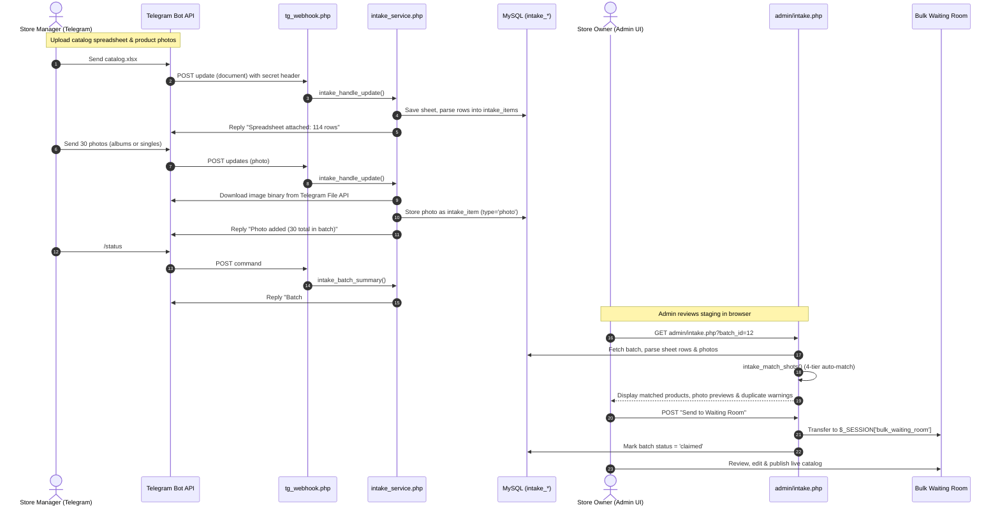
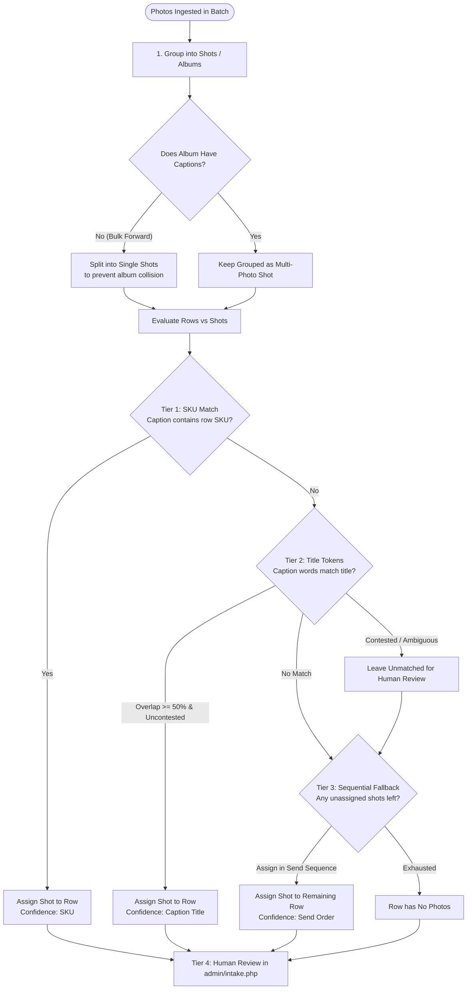

# Velora Telegram Bot Intake & Image Staging Engine
## Comprehensive Technical Architecture & Operational Guide

---

### Table of Contents
1. [Executive Summary & Purpose](#1-executive-summary--purpose)
2. [End-to-End Architectural Lifecycle](#2-end-to-end-architectural-lifecycle)
3. [Component Breakdown & Source Structure](#3-component-breakdown--source-structure)
4. [Security, Authentication & Rate Limiting](#4-security-authentication--rate-limiting)
5. [Data Ingestion & Storage Pipeline](#5-data-ingestion--storage-pipeline)
   - 5.1 [Spreadsheet Ingestion (.csv & native .xlsx)](#51-spreadsheet-ingestion-csv--native-xlsx)
   - 5.2 [Photo Ingestion & Telegram File API](#52-photo-ingestion--telegram-file-api)
   - 5.3 [Idempotency & Deduplication](#53-idempotency--deduplication)
6. [The 4-Tier Photo Matching Engine](#6-the-4-tier-photo-matching-engine)
   - 6.1 [Shot & Album Aggregation](#61-shot--album-aggregation)
   - 6.2 [Tier 1: Direct SKU Extraction](#62-tier-1-direct-sku-extraction)
   - 6.3 [Tier 2: Token-Based Title Matching](#63-tier-2-token-based-title-matching)
   - 6.4 [Tier 3: Sequential Chronological Fallback](#64-tier-3-sequential-chronological-fallback)
   - 6.5 [Tier 4: Interactive Manual Admin Review](#65-tier-4-interactive-manual-admin-review)
7. [Interactive Bot Lifecycle & Chat Commands](#7-interactive-bot-lifecycle--chat-commands)
8. [Admin Review UI & Waiting Room Handoff](#8-admin-review-ui--waiting-room-handoff)
9. [Database Schema Reference](#9-database-schema-reference)
10. [CLI Operations & Diagnostics](#10-cli-operations--diagnostics)

---

### 1. Executive Summary & Purpose

The **Velora Telegram Intake Engine** allows store administrators and inventory managers to stage bulk product catalog drops directly from mobile phones using a private Telegram bot.

#### The Core Problem It Solves
Merchants regularly receive inventory catalogs via mobile messaging apps (e.g., WhatsApp, Telegram) consisting of:
- A wholesale spreadsheet (`.csv` or `.xlsx`) containing product titles, descriptions, categories, SKUs, and prices.
- A flurry of product photography sent as individual shots or multi-photo albums, often without file names, forwarded out of order, or without structured metadata.

Manually downloading hundreds of images to a desktop, renaming them to match SKUs, resizing, and uploading them via traditional web dashboards is tedious and error-prone. The Telegram intake engine automates this pipeline into a **staging and heuristic matching workflow** that requires zero desktop preparation, culminating in a single-click review inside the Velora Admin Panel.

> **Staging vs. Publishing Isolation:** The Telegram Bot **never** writes directly into the live `products` or `product_images` tables. Everything ingested via Telegram is staged in isolated intake tables (`intake_batches` and `intake_items`). Products must be explicitly reviewed and committed through the CSRF-protected Admin Panel (`admin/intake.php` -> Bulk Waiting Room).

---

### 2. End-to-End Architectural Lifecycle



---

### 3. Component Breakdown & Source Structure

| File | Primary Responsibility |
| :--- | :--- |
| `tg_webhook.php` | **Public Webhook Endpoint**. Validates Telegram secret headers, checks whitelist authorization, reads raw JSON input, and routes updates to the intake service. |
| `includes/intake_service.php` | **Core Ingestion Engine**. Handles database migrations (`intake_batches`, `intake_items`), Telegram REST API calls (`sendMessage`, `getFile`), file downloading, MIME verification, file system storage, chat command handling (`/status`, `/undo`, `/clear`), and batch state transitions. |
| `includes/intake_matcher.php` | **Pure Heuristic Matching Engine**. Zero database dependencies. Groups photos into logical shots/albums, extracts SKUs from captions, calculates token-overlap scores against product titles, and handles sequential send-order fallbacks. |
| `includes/intake_xlsx.php` | **Native XLSX Parser**. Lightweight, zero-external-dependency Excel parser using PHP's native `ZipArchive` and `SimpleXML` to read shared strings and sheet cell values up to 5,000 rows. |
| `admin/intake.php` | **Admin Staging Review GUI**. Visual dashboard listing active/historical batches, interactive product-photo association table, thumbnail image picker modal, catalog duplicate pre-checks, and handoff to the Bulk Waiting Room. |
| `tools/tg_set_webhook.php` | **CLI Utility**. Sets or deletes the Telegram webhook URL with the required secret token. |
| `tools/tg_webhook_info.php` | **CLI Utility**. Inspects Telegram webhook health, pending updates count, SSL errors, and configuration. |
| `tools/tg_simulate_update.php` | **CLI Utility**. Simulates Telegram updates locally without an active internet webhook. |

---

### 4. Security, Authentication & Rate Limiting

The Telegram ingestion pipeline implements layered security:

```
[ Incoming Request to tg_webhook.php ]
                  |
                  v
        Is TG_WEBHOOK_SECRET set?
         |-- NO  --> HTTP 503 Service Unavailable ("Webhook not configured")
         \-- YES --> Continue
                  |
                  v
  Does X-Telegram-Bot-Api-Secret-Token match?
  (via timing-safe hash_equals)
         |-- NO  --> HTTP 401 Unauthorized
         \-- YES --> Continue
                  |
                  v
          Is sender chat_id in
         TG_ALLOWED_CHAT_IDS whitelist?
         |-- NO  --> HTTP 200 OK (Drop silently, zero processing)
         \-- YES --> Process Update & Dispatch Actions
```

#### 1. Secret Token Verification
Telegram supports an arbitrary secret token in the `setWebhook` API call. Every request sent by Telegram includes:
`X-Telegram-Bot-Api-Secret-Token: <TG_WEBHOOK_SECRET>`
In `tg_webhook.php`, this is validated using `hash_equals()` to prevent timing attacks. If mismatched, the request is rejected immediately with `HTTP 401`.

#### 2. Chat ID Authorization Whitelist
In `config.php`, `TG_ALLOWED_CHAT_IDS` defines a comma-separated list of approved Telegram Chat IDs. If someone discovers the bot and messages it:
- If `TG_ALLOWED_CHAT_IDS` is configured and does not match the sender, `tg_webhook.php` responds with `HTTP 200 OK` (so Telegram stops retrying), but logs an authorization drop and discards the payload without allocating disk space or running database queries.

#### 3. Strict Payload Size & Quota Caps
Defined in `includes/intake_service.php`:
- `INTAKE_MAX_IMAGE_BYTES`: `8 * 1024 * 1024` (8 MB per image).
- `INTAKE_MAX_SHEET_BYTES`: `2 * 1024 * 1024` (2 MB per spreadsheet).
- `INTAKE_MAX_PHOTOS`: `400` photos per pending batch.
- Over-quota uploads trigger an immediate descriptive reply back to the user via Telegram and are rejected.

---

### 5. Data Ingestion & Storage Pipeline

#### 5.1 Spreadsheet Ingestion (.csv & native .xlsx)
When a document is sent to the bot:
1. **MIME & Extension Inspection:** The bot verifies the extension is `.csv` or `.xlsx`.
2. **Download & Storage:** The binary file is retrieved from Telegram's File API and stored under:
   `storage/uploads/intake/intake_sheet_<timestamp>_<random8hex>.<ext>`
3. **Parsing:**
   - **CSV Files:** Parsed using native PHP stream `fgetcsv()` with automatic UTF-8 BOM stripping.
   - **XLSX Files:** Handled by `includes/intake_xlsx.php`. Because shared hosting often lacks Composer or `phpoffice/phpspreadsheet`, Velora includes a zero-dependency streaming XML parser that unzips the workbook in-memory and extracts values from `xl/sharedStrings.xml` and `xl/worksheets/sheet1.xml`.
4. **Header Mapping:**
   Columns are normalized using `intake_normalize_header()`:
   - `Title`, `Product Name`, `Item`, `Name` -> `title`
   - `Price`, `Unit Price`, `Selling Price`, `Cost` -> `price`
   - `SKU`, `Code`, `Item Code`, `Reference` -> `sku`
   - `Category`, `Dept`, `Collection` -> `category`
   - `Stock`, `Qty`, `Quantity` -> `stock`
   - `Description`, `Details`, `Notes` -> `description`
5. **Database Records:**
   A record is saved into `intake_items` with `item_type = 'sheet'`. The parsed row count is saved in the batch metadata. If a previous spreadsheet existed in the same active batch, it is replaced and deleted from disk.

#### 5.2 Photo Ingestion & Telegram File API
When photos are sent:
1. **Resolution Selection:** Telegram sends an array of `PhotoSize` objects. The bot selects the last entry (`end($update['message']['photo'])`), guaranteeing the highest resolution available.
2. **Binary Fetching:** The bot calls `getFile` via the Telegram Bot API to obtain the `file_path`, then streams the binary content via `tg_download()`.
3. **Integrity Validation:** Before saving to disk, the raw bytes are validated:
   ```php
   $finfo = finfo_open(FILEINFO_MIME_TYPE);
   $mime = finfo_buffer($finfo, $binary);
   if (!in_array($mime, ['image/jpeg', 'image/png', 'image/webp'], true)) {
       // Rejected immediately
   }
   ```
4. **Storage:** The image is written to `storage/uploads/intake/<timestamp>_<random8hex>.<ext>` with file permissions `0644`.
5. **Database Record:** An entry is inserted into `intake_items` with:
   - `item_type`: `'photo'`
   - `file_path`: Relative web-accessible path (e.g., `storage/uploads/intake/...`)
   - `caption`: Trimmed caption text if sent with the photo.
   - `media_group_id`: Telegram's album identifier (if sent as part of a multi-photo album).
   - `telegram_message_id`: For idempotency.

#### 5.3 Idempotency & Deduplication
Telegram's delivery model guarantees *at-least-once* delivery. If a server takes longer than a few seconds to respond, Telegram retries the exact same update.
To prevent duplicate files and duplicate database rows:
- `intake_items` enforces a unique key on `(batch_id, telegram_message_id)`.
- Before processing an incoming message, `intake_message_seen()` checks if the `message_id` already exists for this batch. If found, it skips ingestion and returns a successful response without re-downloading.

---

### 6. The 4-Tier Photo Matching Engine

The matching engine in `includes/intake_matcher.php` binds ingested photos to spreadsheet rows.



#### 6.1 Shot & Album Aggregation (`intake_group_shots`)
Telegram passes a `media_group_id` whenever a user selects multiple photos at once.
- **The Forwarding Quirk:** In practice, merchants frequently forward 30 or 40 photos at once from WhatsApp into Telegram. Telegram automatically stamps all 30 photos with the same `media_group_id`. If treated as a single album, all 30 photos would be assigned to product #1, leaving the remaining 29 products with no images.
- **The Heuristic Solution:** `intake_group_shots()` analyzes the album:
  - If any photo in the album has a caption, the album is preserved as a cohesive multi-photo product shot.
  - If **none** of the photos in the album have captions, it assumes a bulk photo dump and **splits every image into an individual single shot**.

#### 6.2 Tier 1: Direct SKU Extraction
If a merchant writes a caption on a photo containing the product's SKU (e.g., `Caption: "SKU-9924 navy blue"` or `Caption: "#VEL-104"`):
- `intake_sku_key()` strips all whitespace, hyphens, and non-alphanumeric symbols and converts to lowercase.
- If the normalized SKU matches a normalized SKU in the spreadsheet, that shot is immediately locked to that row.

#### 6.3 Tier 2: Token-Based Title Matching
If no SKU is found, the engine analyzes product titles and captions:
- Captions and titles are normalized into word tokens (`intake_tokens()`), filtering out noise words (`the`, `and`, `for`, `with`, `size`, `color`, `pcs`).
- An overlap score is computed:
  $$\text{Score} = \frac{\text{Shared Significant Tokens}}{\text{Total Tokens in Title}}$$
- **Confidence Threshold:** The overlap score must be >= 0.50 (at least 50% of the product title words appear in the caption).
- **Disambiguation Guard:** If a caption matches more than one product row with the same score, the engine **refuses to guess** to avoid mismatching variants. It leaves the shot for manual review.

#### 6.4 Tier 3: Sequential Chronological Fallback
Any shots remaining unmatched after Tiers 1 and 2 are assigned in chronological send order to the remaining unassigned rows in the spreadsheet. This handles the common scenario where a merchant sends an itemized sheet and then uploads the product photos in matching sequence.

#### 6.5 Tier 4: Interactive Manual Admin Review
The matching engine never permanently locks assignments without admin oversight:
- In `admin/intake.php`, every assigned photo displays its matching confidence badge:
  - `[SKU: XYZ]` (High confidence)
  - `[Caption Match]` (Medium confidence)
  - `[Order #N]` (Sequential fallback)
  - `[Unmatched]` (Requires selection)
- Admins can click any thumbnail to open the full-screen photo picker modal and reassign, add, or detach images with a single click.

---

### 7. Interactive Bot Lifecycle & Chat Commands

The bot provides real-time conversational feedback to the user in Telegram:

| Command | Action / Behavior |
| :--- | :--- |
| `/start` or `/help` | Explains how to use the bot: instructions on sending a `.csv`/`.xlsx` catalog, sending product photos, and checking status. |
| `/status` | Returns a concise overview of the active pending batch: number of spreadsheet rows parsed, number of photos staged, total disk space consumed, and a direct URL to the admin intake screen. |
| `/undo` | Removes the single most recently sent item (deleting the file from `storage/uploads/intake/` and removing its database record). |
| `/clearsheet` | Removes the currently attached spreadsheet from the batch without deleting any uploaded photos. |
| `/clearphotos` | Deletes all uploaded photos from the active batch while keeping the spreadsheet intact. |
| `/clear` | Discards the entire active batch and permanently cleans up all associated files on disk. |

#### Batch State Machine
Batches progress through three strict states in `intake_batches`:
1. `pending`: The active working batch for a given Telegram `chat_id`. Any new photos or sheets sent by this chat are added to this batch.
2. `claimed`: Set when the admin clicks **"Send to Waiting Room"** in the web panel. Once claimed, the batch is locked from further Telegram updates. The next message from the merchant automatically initiates a new `pending` batch.
3. `discarded`: Set when an admin clicks "Discard Batch" in the admin panel or the merchant issues `/clear`. Files on disk are unlinked and purged.

---

### 8. Admin Review UI & Waiting Room Handoff

Located at `admin/intake.php`:

#### 1. Batch Selector & Overview
Admins can view active batches, historical claimed batches, and discarded drops. Summary metrics display total sheet rows, photo counts, and unassigned image warnings.

#### 2. Duplicate Detection
Before staging products to the waiting room, `admin/intake.php` cross-references incoming rows against the live store:
- Queries `products` by `sku` and `name`.
- Flags items that already exist in the catalog with a clear visual alert (`Existing product: SKU exists in store`).
- Admins can toggle whether existing items should be skipped or updated.

#### 3. Photo Picker Modal
Every product row renders a thumbnail preview of its matched photos. Clicking the photo or the change button triggers an interactive modal displaying all uploaded images in the batch, enabling one-click re-binding.

#### 4. The Waiting Room Bridge
Clicking **"Send to Waiting Room"**:
1. Formats each row into the canonical bulk-product structure (title, slug, sku, price, stock, category_id, image path, gallery paths, and description).
2. Stores the data in `$_SESSION['bulk_waiting_room']`.
3. Sets the batch status in `intake_batches` to `'claimed'`.
4. Redirects the admin directly to:
   `admin/bulk_products.php?tab=waiting_room`
5. The admin can now perform final price tweaks, bulk category overrides, and click **"Publish Products"** to create live store items.

---

### 9. Database Schema Reference

The intake system automatically provisions two tables upon first execution (`intake_ensure_tables()`):

#### Table: `intake_batches`
```sql
CREATE TABLE IF NOT EXISTS intake_batches (
    id INT UNSIGNED AUTO_INCREMENT PRIMARY KEY,
    chat_id BIGINT NOT NULL,
    status ENUM('pending', 'claimed', 'discarded') NOT NULL DEFAULT 'pending',
    title VARCHAR(255) NULL,
    notes TEXT NULL,
    created_at DATETIME NOT NULL DEFAULT CURRENT_TIMESTAMP,
    updated_at DATETIME NOT NULL DEFAULT CURRENT_TIMESTAMP ON UPDATE CURRENT_TIMESTAMP,
    INDEX idx_chat_status (chat_id, status)
) ENGINE=InnoDB DEFAULT CHARSET=utf8mb4 COLLATE=utf8mb4_unicode_ci;
```

#### Table: `intake_items`
```sql
CREATE TABLE IF NOT EXISTS intake_items (
    id INT UNSIGNED AUTO_INCREMENT PRIMARY KEY,
    batch_id INT UNSIGNED NOT NULL,
    item_type ENUM('sheet', 'photo') NOT NULL,
    telegram_message_id BIGINT NULL,
    media_group_id VARCHAR(128) NULL,
    file_path VARCHAR(255) NOT NULL,
    original_name VARCHAR(255) NULL,
    mime_type VARCHAR(64) NULL,
    file_size INT UNSIGNED NOT NULL DEFAULT 0,
    caption TEXT NULL,
    meta JSON NULL,
    created_at DATETIME NOT NULL DEFAULT CURRENT_TIMESTAMP,
    INDEX idx_batch_type (batch_id, item_type),
    UNIQUE KEY uniq_batch_msg (batch_id, telegram_message_id),
    CONSTRAINT fk_intake_items_batch
        FOREIGN KEY (batch_id) REFERENCES intake_batches(id)
        ON DELETE CASCADE
) ENGINE=InnoDB DEFAULT CHARSET=utf8mb4 COLLATE=utf8mb4_unicode_ci;
```

---

### 10. CLI Operations & Diagnostics

Velora includes dedicated CLI tools in `tools/` for configuring and maintaining the Telegram intake system:

#### Setting the Webhook
Registers your public HTTPS endpoint and secret token with Telegram:
```bash
php tools/tg_set_webhook.php
```
*Reads `TG_BOT_TOKEN`, `TG_WEBHOOK_URL`, and `TG_WEBHOOK_SECRET` from `.env` and issues a `setWebhook` call to Telegram.*

#### Inspecting Webhook Status
Verifies live connectivity, SSL status, and pending update counts:
```bash
php tools/tg_webhook_info.php
```

#### Simulating Updates Locally (Offline Testing)
Enables end-to-end testing of photo matching, command responses, and sheet ingestion on local development machines without opening a public tunnel:
```bash
php tools/tg_simulate_update.php --type=command --text="/status"
php tools/tg_simulate_update.php --type=sheet --file="test_catalog.csv"
php tools/tg_simulate_update.php --type=photo --file="sample_item.jpg" --caption="SKU-1002 Dress"
```
